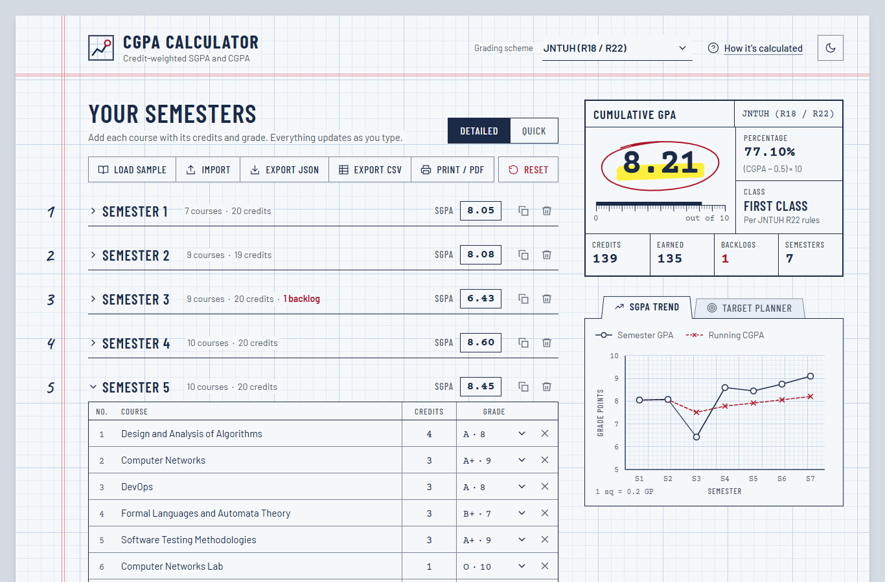
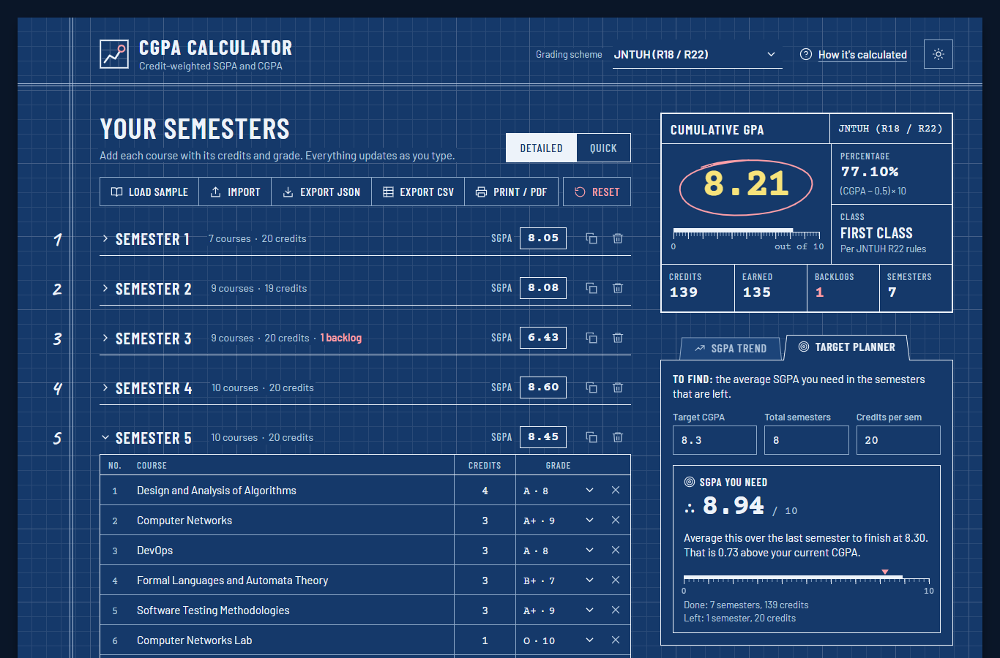
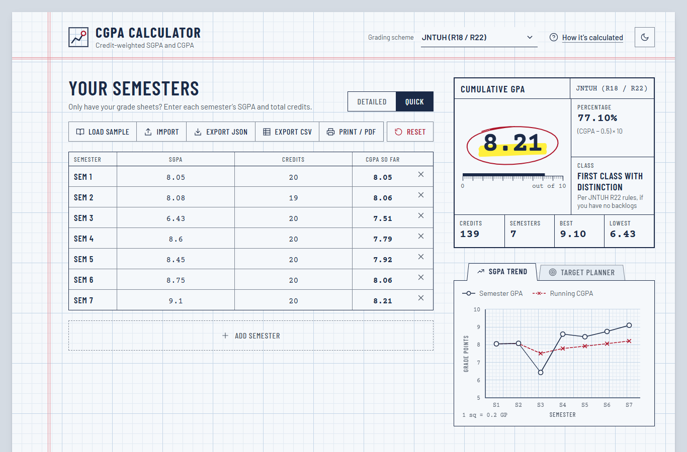
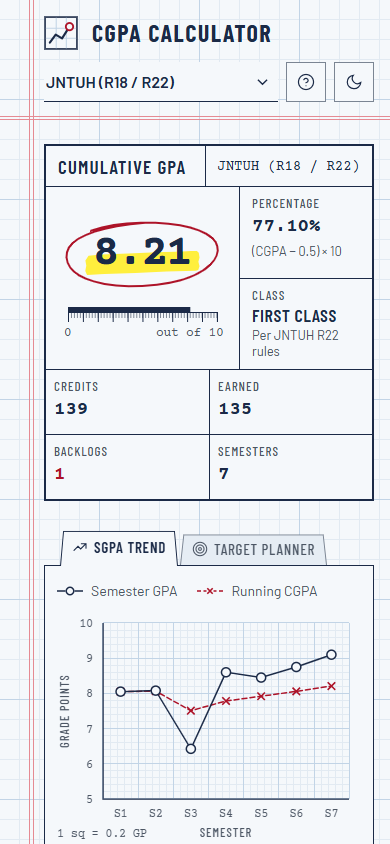
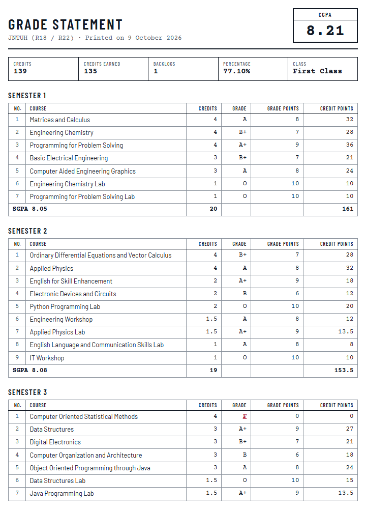

# CGPA Calculator

A credit-weighted SGPA and CGPA calculator for Indian university grading schemes, with a target planner, an SGPA trend chart and a printable grade statement. Plain HTML, CSS and JavaScript, no build step and no dependencies.




I built this because every CGPA calculator I found online either averaged the SGPAs (which is wrong as soon as semesters have different credits) or didn't know my university's percentage formula. This one does the maths the way the regulations describe it, and shows its work.

## Features

- **Two ways to enter data.** *Detailed* mode takes every course with its credits and grade. *Quick* mode takes just the SGPA and total credits from each grade sheet. Switching between them keeps both sets of data.
- **Live results.** SGPA per semester, CGPA, total and earned credits, backlogs, equivalent percentage and degree class update on every keystroke. A screen reader hears a short summary once you pause typing.
- **Five grading presets.** JNTUH (default), VTU, Anna University, a generic UGC CBCS 10-point scale and the US 4.0 scale. Each has its own grade table and percentage formula.
- **SGPA trend chart.** Hand-drawn SVG with a running CGPA line, hover and keyboard tooltips, and an axis that scales to the scheme's maximum.
- **Target planner.** "I want 8.5 after 8 semesters, and the remaining ones are about 20 credits each" gives the average SGPA you need, rounded up. It also tells you when the target is already safe or out of reach, and what the best possible finish is.
- **Semester tools.** Add, duplicate, remove and collapse semesters. Press Enter in the last course row to add another one. New rows start at the scheme's usual credit value.
- **Handles awkward input.** Half credits (1.5 credit labs), zero-credit mandatory courses, ungraded courses while results are pending, out-of-range values (flagged in red, never counted) and grades that don't exist in the selected scheme. You never see `NaN`.
- **Saves itself.** Everything is stored in `localStorage`. There is a sample data set (a JNTUH CSE student with seven semesters of results), reset with confirmation, JSON backup and restore, and CSV export.
- **Print / Save as PDF.** A separate print stylesheet turns the data into a marksheet-style statement with per-semester tables, a summary and the trend chart.
- **"How it's calculated" panel.** The formulas, the worked example from the JNTUH R22 regulations and the rounding rules, with the grade table for whichever scheme is selected.
- **Dark mode, responsive, keyboard friendly.** Follows the system theme until you pick one. Works from a 360px phone up to a wide desktop, with visible focus styles, labelled controls and arrow-key tabs.



## Supported grading schemes

| Scheme | Grade points | Percentage | Class shown |
| --- | --- | --- | --- |
| JNTUH (R18 / R22), default | O 10, A+ 9, A 8, B+ 7, B 6, C 5, F 0, Ab 0 | (CGPA − 0.5) × 10 | Yes |
| VTU (2021 scheme) | O 10, A+ 9, A 8, B+ 7, B 6, C 5, P 4, F 0 | CGPA × 10 | No |
| Anna University (R2021) | O 10, A+ 9, A 8, B+ 7, B 6, C 5, U 0 | CGPA × 10 | Yes |
| Generic 10-point (UGC CBCS) | O 10, A+ 9, A 8, B+ 7, B 6, C 5, P 4, F 0 | CGPA × 9.5 | No |
| 4.0 scale (US) | A 4.0, A− 3.7, B+ 3.3, B 3.0, B− 2.7, C+ 2.3, C 2.0, C− 1.7, D+ 1.3, D 1.0, F 0 | None | No |

Where the numbers come from:

- **JNTUH**: grade table, SGPA/CGPA formulas and the percentage formula are from clauses 9 and 11.2 of the R22 B.Tech academic regulations. The class bands (Distinction from 8.00 with no backlogs, First Class from 7.00, Second Class from 6.00, Pass from 5.00) are from clause 12 of R22. R18 uses the same grades and conversion, but I have not checked its class bands.
- **Anna University**: grade table and `CGPA × 10` are from the R2021 regulations for affiliated colleges (clause 15). Clause 15.5 says U grades are left out of the GPA altogether, so an arrear doesn't lower it until it is cleared; the calculator follows that. Classes are from clause 16.2.
- **VTU**: VTU's own site lists `(CGPA − 0.75) × 10` only for the 2015, 2017 and 2018 schemes. For the 2021 scheme the conversion is `CGPA × 10`, which is what the preset uses.
- **Generic CBCS**: the `× 9.5` factor is the common convention (CBSE and some CBCS universities use it). Check what your own university prints.

The class is only shown for schemes where I could read the rule in the regulations. "No backlogs" stands in for "passed everything at the first attempt", since the calculator doesn't know your exam history.

## Getting started

```bash
git clone https://github.com/preransai/cgpa-calculator.git
cd cgpa-calculator
```

The JavaScript is split into ES modules, and browsers won't load modules from a `file://` URL, so open it through any static server:

- **VS Code**: install the Live Server extension, right-click `index.html` and choose *Open with Live Server*.
- **Python**: `python -m http.server 8000`, then open <http://localhost:8000>.
- **Node**: `npx serve`, then open the URL it prints.

There is nothing to install or build.

### Deploying to GitHub Pages

1. Push the repository to GitHub.
2. Open **Settings → Pages**.
3. Under *Build and deployment*, set **Source** to *Deploy from a branch*, pick `main` and the `/ (root)` folder, and save.

After the first deploy finishes (a minute or so), the live URL appears at the top of the same Pages screen. All paths in the project are relative, so it works from the `/cgpa-calculator/` sub-path without changes.

## Project structure

```text
cgpa-calculator/
├── index.html           markup, SVG icon sprite and <template>s for rows and cards
├── css/
│   ├── base.css         design tokens for light and dark, buttons, form controls
│   ├── app.css          layout and components
│   └── print.css        the printable grade statement
├── js/
│   ├── schemes.js       grading presets                     (pure)
│   ├── calc.js          SGPA / CGPA, percentage, class       (pure)
│   ├── planner.js       target planner                       (pure)
│   ├── io.js            JSON import/export, CSV export       (pure)
│   ├── state.js         state shape, edit helpers, localStorage
│   ├── sample.js        the demo student
│   ├── format.js        number formatting
│   ├── main.js          event wiring
│   └── ui/              editor, summary, chart, planner panel, report, dialogs
├── tests/               node:test suites for the pure modules
└── docs/screenshots/
```

## How it works

For one semester, each course earns credit points (credits × grade points) and

```text
SGPA = Σ(Cᵢ × Gᵢ) / ΣCᵢ
```

The CGPA uses the same formula over **every course in every semester**, so it is total credit points over total credits. It is not the average of the SGPAs. With 20 credits at 9.00 and 10 credits at 6.00, the average of the two SGPAs is 7.50 but the CGPA is (180 + 60) / 30 = 8.00. Quick mode does the same thing with `SGPA × credits` as each semester's credit points. Because the SGPAs on grade sheets are already rounded, a Quick mode CGPA can differ from the official one by about 0.01.



A few decisions I made along the way:

- **The maths lives in pure modules.** `calc.js`, `planner.js`, `schemes.js` and `io.js` don't touch the DOM, so the tests import exactly the code the page runs. The UI modules only read results and draw them.
- **A scheme is data plus two small functions.** Grade table, maximum, a `percentage.convert` function and an optional `classify` function. Anna University's rule is one flag, `excludeFailed`. Adding a university means adding an object to `schemes.js`.
- **Rounding happens once, at the end.** Everything stays at full precision and is rounded to two decimals only when displayed, like a grade sheet. The CGPA is never built from rounded SGPAs. Percentage and class use the rounded CGPA, because that is the number printed on the memo. `round()` shifts through exponent notation so that 7.245 becomes 7.25 rather than 7.24. The planner rounds the required SGPA *up*, since rounding down could leave you 0.01 short.
- **Invalid input is ignored, never coerced.** A course counts only when its credits are between 0 and 30 and its grade exists in the current scheme. If you switch schemes, grades that don't exist there (say `Ab` in VTU) are kept and marked in red, not deleted, so switching back restores them.
- **Typing never re-renders the inputs.** The semester list is rebuilt only for structural changes (add, remove, duplicate, import, scheme or mode switch). On each keystroke only the numbers, badges, chart and planner update, so the cursor never jumps.
- **Storage is optional.** Every `localStorage` call is wrapped in `try/catch`, and saved or imported data goes through the same `normalizeState` function, so a corrupted or hand-edited file can't break the page.

On a phone the results move above the editor, and *Print / PDF* produces a statement like the one on the right:

<p align="center">
  
  &nbsp;&nbsp;
  
</p>

## Running tests

The tests use Node's built-in test runner, so there is nothing to install. Node 20 or newer:

```bash
npm test
```

There are 64 tests across five files. They cover SGPA/CGPA maths (including both worked examples from the JNTUH R22 regulations, 152 / 21 = 7.24 and 518 / 69 = 7.51), credit weighting compared with naive averaging, rounding edge cases, failed and absent courses, Anna University's U rule, empty and zero-credit semesters, every preset's percentage formula and class bands, the target planner (possible, already reached, impossible, no semesters left, bad input), JSON round trips, CSV escaping, and `localStorage` that throws.

## What I'd improve next

- **More universities, and custom schemes.** Mumbai, Osmania, JNTUK and others, plus a small editor to define your own grade table instead of editing `schemes.js`.
- **Supplementary attempts.** Record when a backlog was cleared, so the distinction rule can be checked properly rather than approximated as "no backlogs right now".
- **Undo instead of confirm dialogs.** Removing a semester should be instant with an undo toast.
- **Browser tests in the repo.** The maths is unit tested, but I checked the UI by hand and with throwaway Playwright scripts. Those should become a proper end-to-end suite.
- **Importing a marks memo.** Parsing a results page or PDF would save typing in 60 courses.

## License

[MIT](LICENSE) © 2026 Preran Sai Yarramasu
